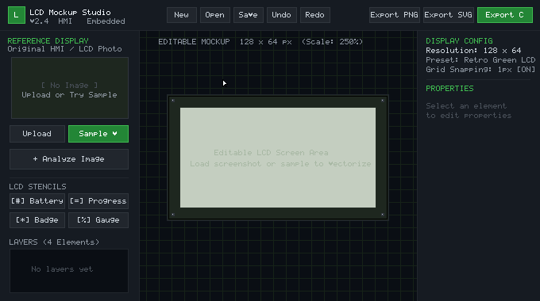
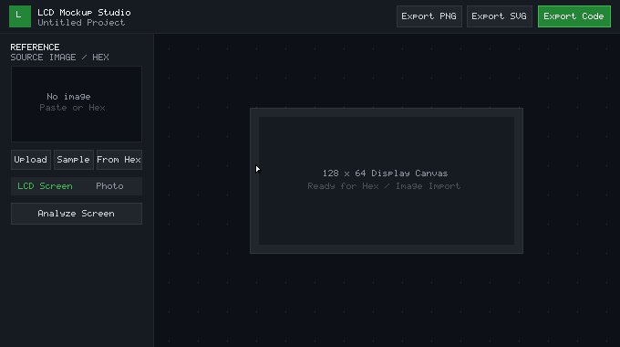

# LCD Mockup Studio

**Convert images to C bitmap arrays — and C arrays back to images — with a live two-way pixel editor. For Arduino, ESP32, STM32 and Pico on SSD1306 OLED, Nokia 5110 and other LCDs.**

A modern, in-browser alternative to image2cpp, LCD Assistant and KasperCalc. Nothing to install, nothing uploaded.

### [▶ Open LCD Mockup Studio in your browser](https://mitrazahiri.github.io/lcd-mockup-studio/)

[](https://github.com/MitraZahiri/lcd-mockup-studio/actions/workflows/deploy.yml)
[](LICENSE)

<div align="center">
  
</div>

## What it does

- **Image → C array.** Drop or paste (<kbd>Ctrl</kbd>+<kbd>V</kbd>) a PNG, JPG, BMP or SVG and get a `PROGMEM` byte array for Adafruit_GFX, U8g2, XBM or MicroPython `framebuf`.
- **C array → image.** Paste an existing `{ 0x00, 0xFF, ... }` array, XBM header or raw hex dump and see it on screen instantly.
- **Two-way pixel editor.** Draw, erase, fill or draw lines on the preview; the C code updates as you edit, and edits to the code update the canvas.
- **Proper 1-bit dithering.** Atkinson, Floyd-Steinberg, Bayer and a scanline "wirephoto" engraver, with contrast / threshold / invert sliders.
- **Display mockups.** Build editable screen layouts (text, frames, battery and signal icons) on SSD1306, ST7920, PCD8544, HD44780 and ST7789 presets, or vectorize a photo of a real screen.
- **Exports:** Arduino `.ino`, C `.h`, MicroPython, RGB565, hex dump, JSON, 1:1 PNG and SVG. Projects can be shared as a single URL.

<div align="center">
  
</div>

## How it compares

| | **LCD Mockup Studio** | image2cpp | LCD Assistant | KasperCalc |
| :--- | :---: | :---: | :---: | :---: |
| Image → C array | ✅ | ✅ | ✅ | ✅ |
| C array → image | ✅ | ❌ | ❌ | ✅ |
| Pixel editor with live code sync | ✅ | ❌ | ❌ | ⚠️ basic |
| Dithering | Atkinson, Floyd-Steinberg, Bayer | Floyd-Steinberg, threshold | threshold | ❌ |
| Output formats | Adafruit_GFX, U8g2, XBM, RGB565, MicroPython | Adafruit_GFX | byte table | byte table |
| Runs in the browser | ✅ | ✅ | ❌ Windows .exe | ✅ |
| Shareable project links | ✅ | ❌ | ❌ | ❌ |

## Quick recipes

### Logo → SSD1306 OLED code
1. Open the [studio](https://mitrazahiri.github.io/lcd-mockup-studio/) and paste your image (<kbd>Ctrl</kbd>+<kbd>V</kbd>) or click **Upload**.
2. Pick a dither style: **Atkinson** for logos, **Floyd-Steinberg** for photos.
3. Click **Export Code**, choose **Adafruit_GFX**, **U8g2** or **MicroPython**.
4. Copy the array, or download a ready-to-flash `.ino` sketch.

```c
const uint8_t logo[] PROGMEM = {
  0x00, 0x1f, 0x00, 0x00, 0x00, 0x3e, 0x00, 0x00,
  // ...
};
u8g2.drawXBMP(0, 0, 128, 64, logo);
```

### Existing C array → editable image
1. Click **Hex to Image** (<kbd>Ctrl</kbd>+<kbd>H</kbd>).
2. Paste the array, e.g. `static const unsigned char logo[] = { 0x00, 0xFF, ... };`.
3. Edit pixels with **Draw / Erase / Fill / Line**; the code updates as you go.
4. Download the PNG, or turn it into a full mockup.

➡️ **[Full feature list, pipeline and keyboard shortcuts](docs/FEATURES.md)**

## Run locally

```bash
git clone https://github.com/MitraZahiri/lcd-mockup-studio.git
cd lcd-mockup-studio
npm install
npm run dev     # local dev server
npm test        # unit tests
npm run build   # production bundle
```

## Contributing

Bug reports, feature ideas and pull requests are welcome. See [CONTRIBUTING.md](CONTRIBUTING.md).
If the tool saved you time, a ⭐ helps other makers find it.

<a href="https://buymeacoffee.com/mitra.zahiri" target="_blank" rel="noopener noreferrer">
  
</a>

## Author

**Mitra Zahiri** · [GitHub](https://github.com/MitraZahiri) · [LinkedIn](https://www.linkedin.com/in/mitra-zahiri) · [Behance](https://www.behance.net/mitrazahiri98)

## License

[MIT](LICENSE) © 2026 Mitra Zahiri
